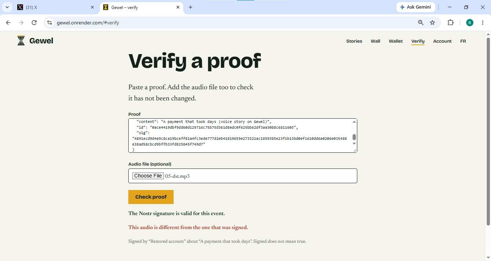
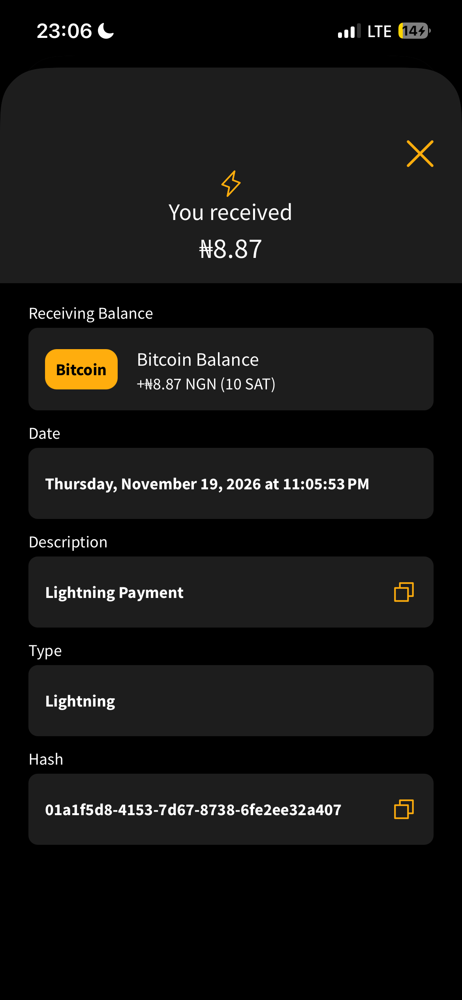
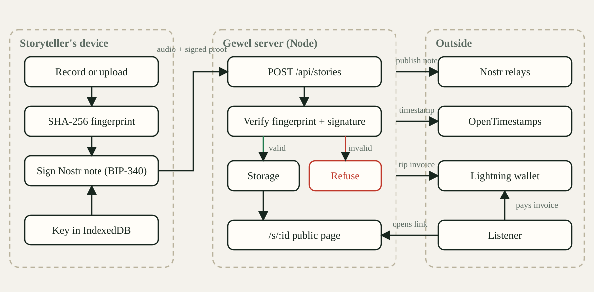

<div align="center">

# Gewel

### Money has a memory. Keep it in the voices that lived it.

A modern *gewel* (griot) for the Bitcoin age: record a story in your own language, **sign it with a key only you hold**, share a link **anyone can verify**, and **get tipped in sats**.

**[Live demo](https://gewel.onrender.com)** · **Demo video: _add link_** · [Technical docs](docs/TECHNICAL.md) · [Demo script](docs/DEMO_SCRIPT.md)

*Built for the Dakar Bitcoin Hack 2026*


</div>

---

## The problem

In January 1994 the CFA franc lost half its value overnight, and it is still pegged to the euro. The people who paid for that day are rarely the ones who tell it. Sending money home to Sub-Saharan Africa is also the most expensive in the world, averaging **8.78%** ([World Bank, Q1 2025](https://remittanceprices.worldbank.org/sites/default/files/rpw_main_report_and_annex_q125_1_0.pdf)).

Existing material is mostly podcasts, essays and videos made *about* people. There is no easy way for an elder, a market trader or a tontine keeper to put a first-hand account on record in their own language, **prove it is theirs and unchanged**, keep it after a phone is wiped, and be **paid directly** by those who listen.

## The idea

Gewel turns a voice recording into a **signed, verifiable, recoverable, tip-able record**.

| | What it means |
|---|---|
| **Signed** | Your browser makes a Nostr key. Your recording is fingerprinted (SHA-256) and signed (BIP-340) on your device. |
| **Verifiable** | Every story has a public link that re-checks the signature and the audio each time it opens. Change one byte and it fails. |
| **Recoverable** | No email, no password. Save your recovery key, and every story returns on any device. |
| **Paid** | Add a Lightning address. Listeners pay from their own wallet. Gewel never holds money. |

**Who it is for.** Primary: community storytellers and student collectors. Secondary: researchers, teachers and diaspora members who want to listen and check a story is genuine.

## See it work

**Both checks pass on an untouched story:**


**Change the audio and the check fails:**



**A tip, paid and received (10 sats over Lightning):**



> The page also says *"Signed does not mean true."* A signature proves who said it and that it was not altered. It does not prove the story is accurate, and Gewel says so.

## How it works

1. **Join** with two fields. Your browser creates a Nostr key.
2. **Save your recovery key** (an `nsec`). It also works in other Nostr apps.
3. **Record or upload** a story. Pick the language and the event it is about.
4. **Sign.** The note carries the audio fingerprint, title, topic, language and author. The server checks it, then sends it to public Nostr relays.
5. **Share** `/s/<id>`. It re-verifies on every visit.
6. **Get tipped.** Listeners request an invoice from your Lightning address and pay from any wallet.
7. **Recover.** Clear the browser, paste the recovery key, and every story returns.

**Also built:** private stories (encrypted in the browser, so the server holds only ciphertext), a public wall of moments that shaped money in Africa, a Nostr Wallet Connect panel, custom relays, Bitcoin timestamp requests (OpenTimestamps), signed deletion, and English/French.



## Why Nostr, Lightning and Bitcoin

- **Nostr** gives every story a standard, portable signature. Any Nostr tool can verify a Gewel story, and the storyteller owns the key.
- **Lightning** lets a listener pay a storyteller directly, in small amounts, with no middleman. That matters where remittance fees run near 9%.
- **Bitcoin timestamps** (OpenTimestamps) can anchor a story's note id to the Bitcoin chain, so its existence at a point in time can be checked later.

## Security by design

- The private key never leaves the browser. Only the public key travels.
- The server recomputes the audio fingerprint and verifies the signature **before** storing anything.
- Deleting a story needs a fresh signed deletion from the author's key.
- Private stories are sealed with AES-256-GCM, with a key derived from the author's Nostr key.
- Tip requests only reach public `https` hosts, with size and time limits, no redirects, and the invoice amount checked.
- A Content Security Policy and HTML escaping on all output.
- Rate limits and an upload size cap (8 MB per story).

**Known limits, stated plainly:** the `nsec` is stored unencrypted in the browser's IndexedDB; whoever holds the recovery key can sign as that user; the server operator could delete files (replication to relays is the planned answer); relays may ignore deletion requests. Full table in [docs/TECHNICAL.md](docs/TECHNICAL.md).

## What is verified

| | Status |
|---|---|
| Signature and audio verification on the live site | ✅ Checked by hand |
| A changed audio file is rejected | ✅ Checked by hand |
| A real Lightning invoice requested from a real Lightning address (500 sats) | ✅ Checked by hand |
| Bitcoin timestamp request accepted by a real OpenTimestamps calendar (pending confirmation) | ✅ Checked by hand |
| Crypto vectors, server checks, encryption, deletion, tips, storage, relays | ✅ Automated (`node test.js`, against mocks where noted) |
| Invoice **paid** by a listener and sats received (10 sats) | ✅ Checked by hand |
| Wipe the browser, restore with the recovery key | ✅ Checked by hand |
| Stories survive a server restart (Neon database) | ✅ Checked by hand |
| `.ots` proof checked with the `ots` tool | ✅ Checked by hand |
| Nostr Wallet Connect with a real wallet | ✅ Checked by hand |
| French translation reviewed by a native speaker | ✅ Reviewed by a native speaker |

Gewel cannot see whether a tip was paid, and says so in the app. Anything not built is labelled in the app.

## How this maps to the judging criteria

| Criterion | Evidence |
|---|---|
| **Usefulness and local impact** | A named user and a real record, sign, share, verify, recover workflow, in French and English, aimed at Francophone West Africa. |
| **Security by design** | Server-side verification before storage, browser-held keys, signed deletion, encrypted private stories, SSRF limits, automated tests. |
| **UX and UI quality** | Audio-first, plain language, no passwords, light and dark themes, reduced-motion setting, mobile layout. |
| **Working MVP** | Live on Render, one-command local run, zero dependencies, passing tests. |
| **Clear pitch and docs** | This README, a demo script, and a full technical document with an honest status. |

## Run it

Node 22 or newer. No `npm install`.

```bash
node test.js      # crypto vectors and server checks
node server.js    # http://localhost:3000, data in ./data
```

Optional settings (`PORT`, `DATA_DIR`, `RELAYS`, `DATABASE_URL`, `GEMINI_API_KEY`) and the Render and Neon deployment steps are in [docs/TECHNICAL.md](docs/TECHNICAL.md). Copy `.env.example` to `.env` for local secrets. `.env` is git-ignored.

## Roadmap

1. Check Bitcoin confirmation of timestamps inside the app.
2. Add Wolof.
3. NIP-44 wallet encryption, Blossom media storage, offline recording queue.

## Docs

- [Technical details, API, full security table](docs/TECHNICAL.md)
- [Three-minute demo script](docs/DEMO_SCRIPT.md)

## Stack

Node (no dependencies) · vanilla JS client · Nostr (NIP-01, 09, 19, 47) · Lightning (LNURL-pay) · OpenTimestamps · Neon Postgres · Render
