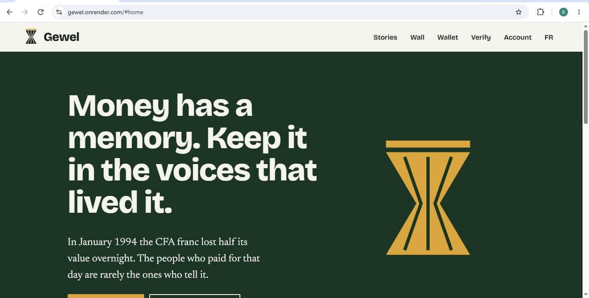
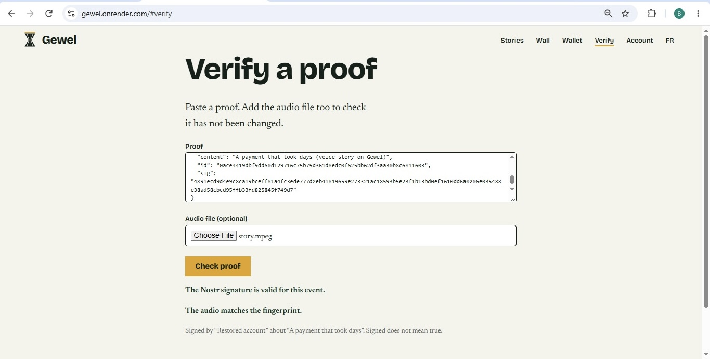

# Gewel

**Stories of money, signed by the people who lived them.**
A modern *gewel* (griot): record a story in your own language, sign it with a key only you hold, share a link anyone can verify, and get tipped in sats.

**Live demo:** https://gewel.onrender.com (free server, first visit after sleep takes about a minute)
**Built for:** Dakar Bitcoin Hack 2026 · **Demo video:** _add link_



## Why

In January 1994 the CFA franc lost half its value overnight. The people who lived it rarely get to tell it, and when they do, nothing proves the recording is theirs or unchanged. Sending money home is also the most expensive in the world for Sub-Saharan Africa, averaging 8.78% ([World Bank, Q1 2025](https://remittanceprices.worldbank.org/sites/default/files/rpw_main_report_and_annex_q125_1_0.pdf)).

Gewel gives elders, traders, tontine keepers and student collectors a way to put a first-hand account on record, prove it is genuine, keep it after a phone is wiped, and be paid directly by listeners.

## How it works

1. **Join in two fields.** No email, no password. Your browser creates a Nostr key.
2. **Record and sign.** The audio is fingerprinted (SHA-256) and signed (BIP-340) in your browser. The note goes to public Nostr relays.
3. **Share a link.** `/s/<id>` re-checks the signature and the audio on every visit. Change one byte and it fails.
4. **Survive a wipe.** Paste your recovery key on any device and every story returns.
5. **Get tipped.** Add a Lightning address. Listeners pay from their own wallet. Gewel never holds money.

Also built: private (browser-encrypted) stories, a public wall, a Nostr Wallet Connect panel, custom relays, OpenTimestamps requests, French.



## Try it in 60 seconds

```bash
node test.js     # crypto vectors + server tests
node server.js   # http://localhost:3000
```
Node 22+, no `npm install`, zero dependencies.

## What is verified

- Automated (`node test.js`, all passing): BIP-340 and nsec vectors, tamper and wrong-signature rejection, signed deletion, private-story encryption, tips against a mock wallet, relays and storage against mocks.
- Checked by hand on the live site: _fill in after your run, e.g. record, sign, wipe and restore on a phone; a real relay answer; a real Lightning tip of N sats; an `.ots` proof checked with `ots verify`._

Anything not yet checked is labelled in the app and listed in [docs/TECHNICAL.md](docs/TECHNICAL.md).

## Docs

- [Technical details, API, security table, honest status](docs/TECHNICAL.md)
- [Demo script](docs/DEMO_SCRIPT.md)

## Stack

Node (no dependencies), vanilla JS client, Nostr (NIP-01, 09, 19, 47), Lightning (LNURL-pay), OpenTimestamps, Neon Postgres for storage, Render for hosting.
