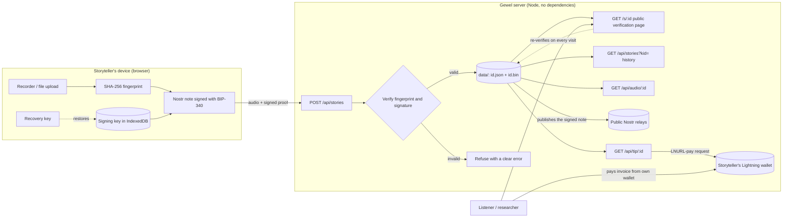
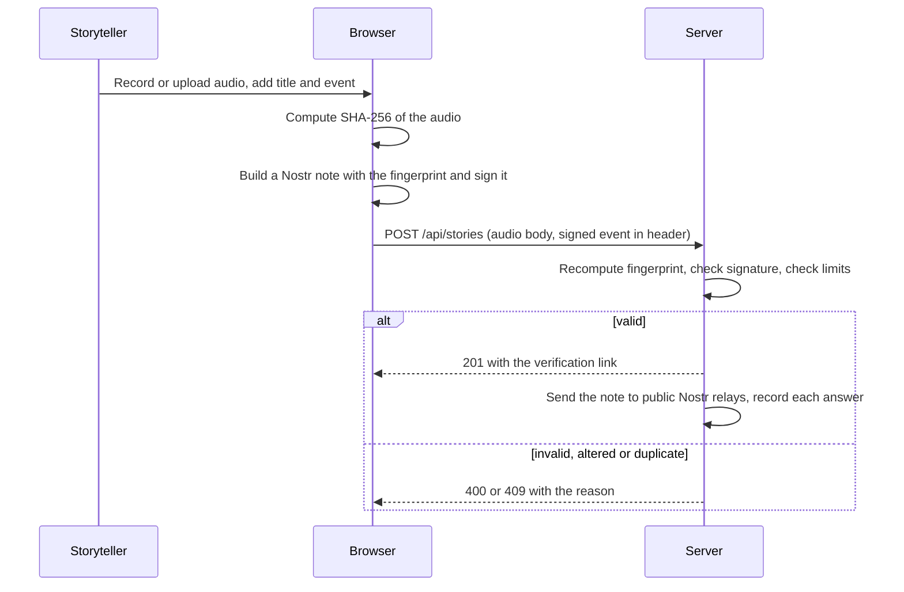
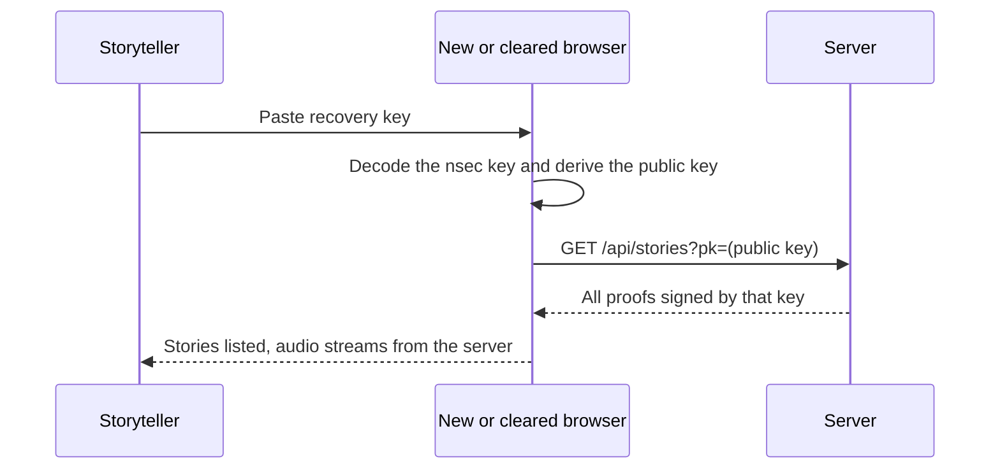

# Gewel: technical details

> Short overview: see the [main README](../README.md).

**Stories of money, signed by the people who lived them.**
Built for the Dakar Bitcoin Hack 2026 (BTrust, Devpost).

A *gewel* is a keeper of a community's memory. Gewel lets storytellers record how money shaped their lives, sign the recording with a key only they control, keep it safe even if they lose their browser data, and share a link that anyone can verify.

---

## 1. The problem

African monetary history is mostly written from outside, and the people who paid for it are rarely credited for telling it. In January 1994 the CFA franc was devalued by 50% overnight, and it is still pegged to the euro at 655.957 ([allAfrica, June 2026](https://allafrica.com/stories/202606180043.html)). Reporting also shows sending money to Sub-Saharan Africa is the most expensive region in the world, averaging 8.78% in Q1 2025 ([World Bank Remittance Prices Worldwide](https://remittanceprices.worldbank.org/sites/default/files/rpw_main_report_and_annex_q125_1_0.pdf)).

Existing material is mostly podcasts, essays and videos. There is no easy way for an elder, a market trader or a tontine keeper to put a first-hand account on record in their own language, prove it is theirs and unchanged, and still have it after a phone is wiped.

**Primary user:** a community storyteller or a student collector recording someone else's account.
**Secondary user:** a researcher, teacher or diaspora member who wants to listen and check that a story is genuine.

## 2. What Gewel does

1. **Create an account.** Two fields. No email, no password. Your browser creates a Nostr key.
2. **Save your recovery key.** This `nsec` key restores your account and all your stories on any device, and works in other Nostr apps.
3. **Record or upload a story.** Pick the language and the event it is about.
4. **Sign.** The audio is fingerprinted (SHA-256) and your key signs a Nostr note (BIP-340 Schnorr) that carries the fingerprint, title, topic, language and author. The server sends the note to public Nostr relays and shows which ones answered.
5. **Share a verification link.** The page `/s/<id>` re-checks the signature and the stored audio every time it opens.
6. **Get tipped.** Add a Lightning address on the Account page. Listeners pay from their own wallet and the sats go straight to the storyteller. Gewel never holds money.
7. **Keep it private or put it on the wall.** Tick "Keep this story private" and the audio is encrypted in the browser with a key derived from your Nostr key, so the server stores ciphertext it cannot play. Or tick "Show it on the public wall" to appear on a timeline of moments that shaped money in Africa.
8. **Use a wallet.** The Wallet page connects any Nostr Wallet Connect wallet: balance, make an invoice, pay an invoice.
9. **Choose your relays.** On the Account page, list up to five `wss://` relays. New story notes go there instead of the server defaults, and the Stories page shows what each relay answered.
10. **Get a Bitcoin timestamp request.** The story's note id is sent to public OpenTimestamps calendar servers. It stays pending until Bitcoin confirms it, usually within hours, and you can download the `.ots` proof to check it with the OpenTimestamps tool.
11. **Switch to French.** The FR/EN button in the header translates the main screens.
12. **Recover.** Clear the browser, paste the recovery key on the join page, and every story returns.

## 3. Architecture



### Saving a story



### Recovering after clearing the browser



## 4. Security by design

| Asset or risk | What we do | Status |
|---|---|---|
| Forged or altered stories | Server recomputes the audio fingerprint and verifies the Nostr (BIP-340) signature before storing anything. Tests cover tampered audio and wrong signatures. | Built, tested |
| Impersonation | The private key is created in the browser and never sent to the server. Only the public key travels. | Built |
| Unauthorised deletion | Deleting needs a fresh signed Nostr deletion (NIP-09) from the author's key. | Built, tested |
| Private stories | Audio is sealed with AES-256-GCM using a key derived (HKDF) from the author's Nostr key. The server and relays only ever see ciphertext. The signed note, with title, topic and author name, stays public. | Built, tested |
| AI key and cost | The Gemini key exists only in the server environment (`.env`, git-ignored) and is sent in a header, never to the browser or logs. Requests need the author's fresh signature, are rate limited per address, and are capped per day. | Built, tested with a mock, and checked by hand once with a real key |
| Sending audio to a third party | The author must confirm each time. Private stories are excluded. | Built |
| Relays you choose | Addresses must be `wss://`, at most five, and must not resolve to private network addresses, so the server cannot be pointed at internal services. | Built, tested (private-address blocking not covered by a test) |
| Timestamp claims | The app only says "pending". It never claims Bitcoin confirmation, because it does not check one. | Built |
| Wallet connection string | It works like a spending key, so it is kept only in this browser and never sent to the server. Use a wallet connection with a small spending limit. It is stored unencrypted in the browser. | Built, limit noted |
| Copies on public relays | Deleting asks relays to remove their copies, but relays may ignore it. The UI says so. | Built, limit noted |
| Key stored in the browser | The nsec is kept unencrypted in this browser's IndexedDB, so a shared computer or a script injection could read it. Output is escaped and a Content Security Policy is set. | Known limit |
| Personal data | No email, phone or password. The server stores a display name the user chooses, and logs hold no personal data. | Built |
| Abuse and oversize uploads | 8 MB limit per story, 40 uploads per hour per address, strict field validation. | Built (limits are in memory) |
| Browser attacks | Content Security Policy, `nosniff`, no referrer. All output is HTML-escaped. | Built (CSP still allows inline script) |
| Lost recovery key | Nobody can recover the account, by design. The UI says so before the user continues. | Built |
| Stolen recovery key | Whoever holds it can sign as the user. The UI warns to store it privately. | Built, warning only |
| Server operator reading stories | Public stories are readable by link. Private stories are encrypted in the browser, so the server holds only ciphertext (the signed note with title, topic and author name stays public). | Built, tested |
| Server operator deleting or withholding stories | Cannot forge signatures, but can remove files. Replication to relays is the planned answer. | Not built |
| Tip requests reaching internal addresses (SSRF) | Wallet hosts must use https and resolve to public addresses, replies are size and time limited, redirects are refused, and the invoice amount is checked against the request. | Built. Private-address blocking has no automated test, and a DNS rebinding race is possible. |
| Fake or wrong invoices | The server checks the invoice amount. It cannot check the invoice signature; the payer's wallet does when paying. | Built, limit noted |
| Storage | Plain files in `data/`. Fine for a demo, not for production. | Known limit |

## 5. API

| Method and path | Purpose |
|---|---|
| `POST /api/stories` | Save a story. Body is the audio. Header `x-event` holds the base64 signed Nostr event (kind 1). Returns `201` or an error. |
| `GET /api/stories?pk=<64 hex>` | List every event signed by a public key, newest first. |
| `POST /api/ai/:id` | Ask for a transcript and English and French translations of a public story. Header `x-event` is a fresh signed Nostr event (kind 27235) from the story's author with tags `e` (story id) and `x`. Three body modes: **empty** (the server uses the stored audio, `x` is the story's audio fingerprint), **WAV audio** (fallback, `x` is its SHA-256), or **JSON `{"text": "..."}`** with `content-type: application/json` (text only, up to 6000 characters, `x` is the SHA-256 of the text). Needs `GEMINI_API_KEY`. |
| `GET /api/ai/:id` | The stored AI result for a story, or `{}`. |
| `GET /api/ai-status` | Whether AI is configured, the model and fallbacks, usage today, the last success and the last error. Never contains the key. |
| `GET /api/ots/:id` | Timestamp request status for a story: `pending`, `failed` or none. |
| `GET /ots/:id.txt` and `GET /ots/:id.txt.ots` | The exact event text (its SHA-256 is the note id) and the `.ots` proof file to check with the OpenTimestamps tool. |
| `GET /api/wall` | Public stories whose authors opted in. Private stories never appear. |
| `GET /api/relays/:id` | What each public relay answered for a story. |
| `GET /api/audio/:id` | Stream the stored audio. |
| `GET /s/:id` | Public verification page for one story. |
| `POST /api/ln` | Set or clear a Lightning address. Body is a signed Nostr event (kind 30078, tag `d=gewel-lightning`, content is the address), less than 10 minutes old. |
| `GET /api/ln?pk=` | Says whether tips are on for a key. Does not reveal the address. |
| `GET /api/tip/:id?sats=N` | Asks the storyteller's wallet (LNURL-pay) for an invoice and returns it after checking the amount. |
| `POST /api/delete` | Delete a story. Body is a fresh signed Nostr deletion event (kind 5) naming the story id. Only the author's key works. |

**Story format.** A story is a standard Nostr kind 1 note, so any Nostr tool can verify it. The note id is the story id.

```json
{ "id": "64 hex", "pubkey": "64 hex", "created_at": 1700000000, "kind": 1,
  "tags": [["title","…"],["topic","…"],["lang","Wolof"],["author","…"],["x","sha256 of the audio"],["t","gewel"]],
  "content": "title (voice story on Gewel)", "sig": "128 hex" }
```

## 6. Run it

Needs Node 22 or newer. No `npm install`.

```bash
node test.js      # crypto vectors and server checks, uses a temporary folder
node server.js    # http://localhost:3000, data in ./data
```

`PORT`, `DATA_DIR` and `RELAYS` (comma-separated `wss://` addresses) change the port, storage folder and relays. Relay publishing needs Node 22 or newer. `ALLOW_LOCAL_LNURL=1` is for tests only; it disables the https and public-address checks.

### Optional: AI transcripts and translation (Gemini)

1. Create a key in Google AI Studio. Check Google's current terms for how content sent to the API is used before sending anyone's story.
2. In the project folder: `cp .env.example .env`, put the key in `.env`, restart the server. `.env` is git-ignored. Never paste the key into code, the browser or a chat.
3. On your Stories page, a public story gets an **Add AI transcript and translation** button. It asks for confirmation, because the audio goes to Google through this server.

How it works: by default the server uses the audio it already stores for the story, so the browser does not upload anything again. The author's fresh signature is required. The server then asks Gemini for a JSON answer through the Interactions API, and falls back to `generateContent` if that endpoint answers 400, 404 or 405. If audio does not work, the author can type the transcript and have only the text translated. The result is stored as `ai-<story id>.json` (and mirrored to Neon when `DATABASE_URL` is set) and shown on the public story page, labelled as machine-made and outside the signature, with the model that answered. Private stories are refused (`404`), and deleting a story deletes its AI result.

If Gemini is busy (HTTP 429 or 5xx) the server retries once, then tries the models in `GEMINI_FALLBACK` (default `gemini-3.6-flash,gemini-3.5-flash-lite`), and records which model answered. The default model is `gemini-3.8-flash`. Model names change often, so if you see "Gemini returned status 404", set `GEMINI_MODEL` to a current model name from Google AI Studio.

Settings: `GEMINI_API_KEY` (server only), `GEMINI_MODEL`, `GEMINI_FALLBACK`, `AI_DAILY_MAX` (default 100 requests a day for the whole server), `AI_RETRY_MS`.

Security: the key is never sent to the browser or logged. Requests need the author's fresh signature, are rate limited and capped per day, and the browser asks for consent before anything is sent to Google. Error messages come from Google's reply and never include the key.

Tests: against a mock Gemini server (request shape and key header, fallback to `generateContent`, busy answers retried, model fallback, stored-audio mode, typed-text mode, author-only access, fingerprint binding, length limit, private stories refused, and the status endpoint never containing the key). Also checked by hand once on the live site with a real Gemini key, using the stored-audio path: transcript plus English and French shown. The typed-text and WAV paths are tested against the mock only.

## Keep stories safe with Neon (free Postgres)

Hosts with an ephemeral filesystem, such as Render's free web service, erase local files when the service restarts, redeploys or sleeps after 15 minutes without traffic (Render docs, "Deploy for Free"). Gewel can mirror everything to a Neon Postgres database over HTTP, with no extra packages.

1. In Neon, create a project and copy its **connection string** (it starts with `postgresql://`).
2. Put it in `.env` as `DATABASE_URL=...` locally, or in your host's environment variables when deployed. It contains a password, so never commit it or paste it in public.
3. Start the server. It creates one table, `gewel_files`, restores every story from it, and then serves. Each save, tip setting, AI result, timestamp record and deletion is written to the database before the server answers. If a database write fails, the upload is refused with an error, and a deletion removes the database copy so it cannot come back.

Tested against a mock of Neon's SQL-over-HTTP endpoint, including a fresh server with an empty disk restoring a story and a failed write being reported. **Not tested against a real Neon database.** Audio is stored as base64 inside one request per file, so very large uploads depend on Neon's request size limit; the 8 MB per story limit is meant to stay under it. Check Neon's current free plan limits (storage, compute hours) before relying on it.

## Deploy on Render

1. Push this repo to GitHub, then in Render choose **New**, **Web Service**, and connect the repo.
2. Runtime **Node**. Build command: `echo ok`. Start command: `node server.js`. Plan **Free**.
3. Environment variables: `DATABASE_URL` (your Neon string), `NODE_VERSION=22` (relay publishing needs Node 22 or newer), `TRUST_PROXY=1` (so rate limits count each visitor, not Render's proxy), `STORE_CAP_MB=100`, and optionally `GEMINI_API_KEY`. Set secrets in Render's dashboard only.
4. Without `DATABASE_URL`, also set `DEMO_NOTICE=Demo server: stories are erased when it restarts or sleeps.` to show a banner.
5. The first visit after a sleep takes about a minute.

`STORE_CAP_MB` (default 300) refuses uploads once total audio reaches that size; it has no automated test.

## 7. Project layout

```
gewel/
├── server.js        verification, storage, relay publishing, public pages, API
├── nostr.js         dependency-free Nostr toolkit: signatures, keys, NIP-04, sealed audio, wallet connect
├── test.js          end-to-end server tests with real signatures
├── package.json     scripts only, no dependencies
├── public/
│   └── index.html   the whole client: landing, about, FAQ, join and restore,
│                    onboarding, stories, verify, account (edit, settings, delete)
└── README.md
```

## 8. Honest status

**Tested automatically (`node test.js`):**
- Cryptography against published vectors: BIP-340 Schnorr and the NIP-19 `nsec` encoding.
- Encryption: shared secret symmetry, NIP-04 round trip, sealed audio opens only with its own key and rejects tampering.
- Server: story checks (valid, duplicate, edited, altered audio, wrong kind, incomplete private story), history by public key, public verification page, private pages with no player, the public wall (opt-in only), signed deletion, Lightning address handling, tip invoices against a mock wallet.
- AI help against a mock Gemini server: request shape and key header, fallback to `generateContent`, busy answers retried, model fallback, stored-audio and typed-text modes, author-only access, fingerprint binding, length limit, private stories refused, result labelled on the public page, and the status endpoint never containing the key.
- Relays the storyteller chooses (refused when not `wss://` or more than five; only the chosen relay used) and timestamp requests against a mock calendar: the note id goes out as a 32-byte digest, the `.txt` file hashes to the note id, the `.ots` file carries the header and digest, and the page says pending.
- Durable storage against a mock Neon SQL-over-HTTP endpoint: a story is mirrored to the database, a failed write is reported and not kept, a fresh server with an empty disk restores it (audio identical, signature still valid), and a deletion removes the database copy.
- Relay publishing and wallet connection **against a mock relay that speaks the real Nostr relay protocol over WebSocket**, including a relay that cannot be reached.

**Never run against the real thing (test these on your machine):**
- Real public Nostr relays and a real Nostr Wallet Connect wallet. The wallet panel uses NIP-04 encryption only; a wallet that supports only NIP-44 will fail with an error. The app shows what the wallet or relay actually answered.
- The whole browser interface: recording, restore from nsec, private playback, wall, wallet, delete. None of the browser code has been run in a browser by me.

**Checked by hand with a real key:** AI transcripts and translation, using the stored-audio path on an English story (transcript plus English and French shown). Not verified: the typed-text and WAV paths against Google, and Wolof or other African-language accuracy, which is unknown.

**Built but unverified against the real thing:**
- **Bitcoin timestamps.** Requests go to the public OpenTimestamps calendars, but I never reached them. The `.ots` file layout follows my understanding of the format and has not been checked with the real `ots` tool. Run `ots upgrade` and `ots verify` on a downloaded proof, and treat a failure as a bug to report.
- **French.** Navigation, forms, headings, buttons and the main explanations are translated. Long paragraphs (most FAQ answers, the About details, some account text) and error messages are still English. A native speaker should review the French before the demo.

**Not built:** confirmation of Bitcoin timestamps inside the app; Blossom media storage; a 12-word phrase (the recovery key is a Nostr `nsec`).

Anything not built is labelled that way in the app. Gewel cannot see whether a tip was paid, and says so.

## 9. How this maps to the judging criteria

| Criterion (from the Devpost page) | Evidence today | Gap |
|---|---|---|
| Usefulness and local impact | Named user, a real record-sign-share-recover workflow, English and French copy planned | No field user testing yet |
| Security by design | Section 4 and automated tests | Private stories, replication |
| UX and UI quality | Audio-first, plain language, light and dark themes, reduced motion setting, mobile layout | Not yet measured on a mid-range phone or slow network |
| Working MVP | One-command run, crypto, server, relay and wallet-protocol tests pass | Browser interface, real relays, a real wallet and real tips not yet tested |
| Clear pitch and docs | This README, diagrams, demo script below | Demo video not recorded |

The hackathon also requires a Bitcoin or Lightning wallet implementation. Lightning tips are built, but whether they count is unconfirmed; ask the organizers. An NWC wallet panel is the fallback.

## 10. Three-minute demo script

1. **Problem (30s).** January 1994, the CFA franc loses half its value overnight. The people who lived it rarely tell it.
2. **Record and sign (45s).** Create an account, save the recovery key, record a short real story, sign it.
3. **Share and verify (45s).** Open the verification link. Show both checks passing. Then show a changed audio file failing on the Verify page.
4. **Survive a wipe (30s).** Clear browser data, restore with the recovery key, stories reappear.
5. **Tip (30s).** Add a Lightning address, open the story link, get an invoice, pay it from a wallet.
6. **Next (20s).** Nostr replication, Bitcoin timestamps, NWC wallet panel.

Use only real, consented recordings in the demo, or label them clearly as samples.

## 11. Roadmap

1. Test real relays, a real wallet, a real tip, a real Gemini key and a real timestamp proof, then deploy a public demo.
2. Check Bitcoin confirmation inside the app, instead of relying on the command-line tool.
3. Finish and review the French (long paragraphs, error messages) and add Wolof.
4. NIP-44 wallet encryption, Blossom storage, offline recording queue.

## 12. Sources

- Dakar Bitcoin Hack rules and judging criteria: https://dakar-bitcoin-hack-2026.devpost.com/
- CFA franc 1994 devaluation and fixed rate: https://allafrica.com/stories/202606180043.html
- Remittance costs: https://remittanceprices.worldbank.org/sites/default/files/rpw_main_report_and_annex_q125_1_0.pdf
- Nostr protocol specifications (NIP-03, 06, 47, 49, 57 and Blossom): https://github.com/nostr-protocol/nips
